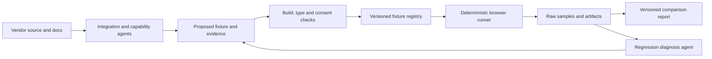

# CookieBench v3 audit and proposal

Audit date: 27 September 2026. The audit below describes the original runner at `fa06799e6abc1b3307e18c0ebfefb4d2dfab206f`. Implementation work now follows this proposal. Historical source links point to that revision because the obsolete CLI collectors and scorer have been removed. No new vendor rankings or production database cutover have been published.

Implementation status: versioned result validation, Effect v4 execution, PostgreSQL migrations and immutable ingestion, legacy preservation, and the noninteractive CLI now exist. Their tests are the acceptance evidence. Controlled browser fixtures test instrumentation; framework consumer fixtures require their own build, type, and consent checks. The full matrix, hosted failure modes, advanced signal suites, field claims, and public rankings remain separate acceptance work. See the root README for current commands and limits.

The current score needs replacing. Several collection and scoring bugs can reward a missing banner, understate transferred bytes, and distort the work being measured. Changing category weights would preserve those problems.

I recommend a performance-first comparison with separate, tested capability results. Highlight banner visibility, page impact, interaction latency, and delivered bytes. Show viewport coverage as presentation information. Make modern framework support, a typed SDK, and headless composition explicit buying criteria.

## What I inspected

| Source | Revision | Scope |
| --- | --- | --- |
| CookieBench | `fa06799e6abc1b3307e18c0ebfefb4d2dfab206f` | CLI entry point, active runner, collectors, scoring, results publishing, fixtures, build configuration |
| [inthhq/inth](https://github.com/inthhq/inth/tree/8dfadbb34b3fae9e99d37453485d6d622ff39ccf) | `8dfadbb34b3fae9e99d37453485d6d622ff39ccf` | Root and CLI manifests, workspace, lint and test configuration |
| [c15t/c15t, v3](https://github.com/c15t/c15t/tree/9993ae57867e33e96783640413a2429b649104c7) | `9993ae57867e33e96783640413a2429b649104c7` | Public exports, selected framework and headless implementation files, benchmark inventory, available docs |

c15t's v3 documentation is still being written. Package exports and implementation files establish that integrations exist; they do not prove their runtime behavior or performance. No c15t v3 or competitor browser suite was run for this audit.

## Findings in the current runner

The CLI imports `commands/benchmark/benchmark-runner.ts`. There are additional runners and collectors under `lib/`; fixing only those would leave the active CLI path unchanged.

| Priority | Finding | Consequence and evidence |
| --- | --- | --- |
| P0 | Missing measurements become successful zeroes | [Scoring](https://github.com/inthhq/cookiebench/blob/fa06799e6abc1b3307e18c0ebfefb4d2dfab206f/packages/cli/src/utils/scoring.ts) replaces nonfinite performance values and null banner timing with zero. `cookieBannerDetected` does not gate the score. A failed banner can earn full UX points. |
| P0 | The detector creates main-thread blocking | [Banner detection](https://github.com/inthhq/cookiebench/blob/fa06799e6abc1b3307e18c0ebfefb4d2dfab206f/packages/cli/src/commands/benchmark/cookie-banner-detector.ts) busy-waits for 100 ms, up to ten times per matching hidden element. It can delay the rendering and interactions it is measuring. |
| P0 | Byte units disagree | [Resource collection](https://github.com/inthhq/cookiebench/blob/fa06799e6abc1b3307e18c0ebfefb4d2dfab206f/packages/cli/src/commands/benchmark/resource-collector.ts) divides bytes by 1024. The runner passes those values to a scorer that treats them as bytes and divides again. Size thresholds are wrong by a factor of 1024 on this path. |
| P1 | Third-party attribution is broken | [Network monitoring](https://github.com/inthhq/cookiebench/blob/fa06799e6abc1b3307e18c0ebfefb4d2dfab206f/packages/cli/src/commands/benchmark/network-monitor.ts) checks whether a URL contains its own hostname. Normal absolute HTTP URLs do, so this branch classifies them as first party. The separate resource collector uses a hostname substring test, which can misclassify lookalike domains and URLs containing the hostname in their path. |
| P1 | Collection changes network behavior | The monitor intercepts every request, fetches it through Playwright, and rewrites response headers. Playwright documents that routing disables HTTP cache. This is unsuitable for measuring normal loading or warm-cache behavior. |
| P1 | Mean request counts can crash scoring | The runner averages third-party request counts, then the scorer calls `Array(count)`. A mean of `1.5` throws `RangeError`. Resource rows should never be fabricated from an average. |
| P1 | TTI and script timing are not valid measurements | [Metrics calculation](https://github.com/inthhq/cookiebench/blob/fa06799e6abc1b3307e18c0ebfefb4d2dfab206f/packages/cli/src/commands/benchmark/metrics-calculator.ts) constructs TTI as the maximum of FCP, DOM completion, and banner timing, plus 1000 ms. The scorer fixes script load time at zero, awarding full points for it. |
| P1 | Visibility and usability are inferred incorrectly | Width and height can satisfy the visibility check even when CSS hides the element. `offsetParent !== null` does not establish that hydration installed a working action handler. Startup delays and polling also affect observed timing. |
| P1 | Iterations have no explicit isolation model | [The runner](https://github.com/inthhq/cookiebench/blob/fa06799e6abc1b3307e18c0ebfefb4d2dfab206f/packages/cli/src/commands/benchmark/benchmark-runner.ts) reuses one page while installing more init scripts, routes, and console listeners. It does not define fresh consent state, warm cache, or returning-visitor state as separate scenarios. |
| P1 | The grade combines outcomes with preferences | Performance gets 40%, bundle strategy 25%, network impact 20%, transparency 10%, and UX 5%. Bundler choice, TypeScript metadata, and inferred open-source status earn points. CLS contributes in two categories. Baseline gets 100 automatically. No action or consent-blocking test establishes functional quality. |
| P1 | The page is too small to represent page impact | The local baseline and c15t pages contain a heading. A banner can become the LCP element. Absolute page totals also include the framework, so they do not isolate CMP overhead. |
| P1 | Benchmark execution can be cached | [Turbo configuration](https://github.com/inthhq/cookiebench/blob/fa06799e6abc1b3307e18c0ebfefb4d2dfab206f/turbo.json) leaves caching enabled for `benchmark`. Timed measurements must execute each time; production builds can still be cached. |

The README also groups FCP and TTI under Core Web Vitals. The current Core Web Vitals are LCP, INP, and CLS. The active runner does not measure INP.

The viewport penalty is a methodological issue, but currently accounts for at most 1.25 points of the overall score. Collection errors and the 25% bundle-strategy category matter much more.

### Executable checks

I ran the existing `calculateScores` implementation with Node 24's TypeScript stripping. Unused runtime imports were removed in memory to run the pure scorer without installing the workspace. No repository implementation changed.

The comparison used FCP 40 ms, LCP 80 ms, CLS zero, blocking zero, and the existing TTI input of 1000 ms. Both cases used three requests, no third-party requests, the same size inputs, and no vendor-specific metadata.

With those inputs:

| Probe | Observed result |
| --- | --- |
| Banner absent, timing null, coverage zero | Overall 87, UX 100 |
| Banner present at 500 ms, coverage 20% | Overall 85, UX 65 |
| All five performance inputs `NaN` | Performance 100 |
| Mean third-party request count `1.5` | `RangeError` |
| External URL `https://vendor.example/cmp.js` passed to the monitor's classification expression | Classified as first party |

The size conversion, busy-wait, lifecycle, and cache findings came from source inspection. Their full browser impact has not been measured. There are no checked-in tests or GitHub Actions workflows in this checkout, and dependencies are not installed.

## What the comparison should show

Default to a table filtered by framework, device profile, deployment mode, and visitor scenario. Put measured values and baseline differences in the cells. Each row should link to its setup, version, evidence, and sample counts.

| Prominent metric | Definition | Reporting rule |
| --- | --- | --- |
| Banner visible | Navigation start to first observed visible banner | Median and p75, observation resolution, and detection success count. Missing expected banner is a failed scenario. |
| Banner usable | Earliest tested input that produces the intended consent state transition | Use a separate action probe and report the tested timing bound. An existing button is insufficient evidence. |
| LCP impact | Native page LCP and paired difference from the same framework without the CMP | Keep the actual LCP element attribution. Also track the shared page's primary content becoming visible so a banner becoming LCP is understandable. |
| CLS impact | Native CLS using the standard session-window algorithm, plus paired baseline difference | Keep input-related shifts separately as diagnostics. Do not sum all shifts and call the result CLS. |
| Interaction responsiveness | Input-to-next-paint for fixed accept, reject, preferences, save, and page interactions | Label synthetic results as lab interactions. Collect lab INP where valid; no interactions means unavailable, never zero. |
| Banner dismissal | Accept/reject input to the first observed frame with the banner and its blocking overlay gone | A headline action metric, reported separately for each action. Include the configured exit animation and confirm that page interaction is restored. |
| JavaScript and CSS cost | Incremental initial and deferred encoded bytes, decoded bytes, and actual transfer bytes | Store each quantity separately in bytes. Include HTML and inline consent state in total page transfer. |
| Main-thread cost | Long-task blocking during a fixed observation window and around actions | Name the window. Call it TBT only when its measurement follows a defined TBT method. Trace-based CMP attribution is diagnostic. |

Keep FCP, TTFB, request counts, endpoint dependencies, consent persistence latency, and script activation latency in the expanded report. Script activation measures action start to confirmed execution of controlled scripts. Include a base workload and a larger script-count workload to expose scaling behavior.

Viewport coverage belongs beside a screenshot, banner position, scroll blocking, and customization options. A larger banner is not inherently a worse CMP. Small, unreadable controls should not win points. Test focus, keyboard access, mobile usability, and whether page content remains usable under the configured policy.

Use two presentation configurations when a product supports them: its documented default and an equivalent customized layout. Keep their results separate. A headless runtime without UI belongs in an engine benchmark; a headless implementation with a complete custom banner can enter the UI comparison.

Google's good-experience thresholds, LCP at most 2.5 s, INP at most 200 ms, and CLS at most 0.1, provide context. Field assessment uses the 75th percentile of real page visits. Repeated local runs do not establish field Core Web Vitals performance. See [Web Vitals](https://web.dev/articles/vitals) and [INP](https://web.dev/articles/inp).

### Delay after accept, reject, and save

Make click-to-dismiss a headline CMP metric. A visitor should be able to see how long the banner remains after choosing. Collect the following milestones from the same browser input timestamp. These durations can overlap and must not be added together.

| Measurement | Endpoint |
| --- | --- |
| Input-to-next-paint | The next presented frame after the interaction's event processing, using the browser's Event Timing measurement where available. This exposes input queueing, handler work, and presentation delay. It does not guarantee a meaningful visual response. |
| Visible acknowledgement | First observed frame showing feedback caused by the action, such as a pressed/loading state or the start of dismissal. A no-op repaint does not qualify. |
| Banner dismissed | First observed frame where the banner and blocking overlay are gone. Verify that scroll locks, focus traps, and invisible overlays no longer prevent the intended page interaction. |
| Consent effective | The intended permissions are applied, verified through public state and controlled allowed/blocked behavior. Closing the banner alone is insufficient. |
| Allowed scripts executed | The controlled scripts actually execute. Report each script and workload completion; a request start or inserted script element is insufficient. |
| Choice persisted | Local consent state survives reload. Where a backend exists, report confirmed remote persistence separately from the local write and UI feedback. |

Run accept all, reject all, and save preferences as separate actions from equivalent fresh state. Include keyboard activation. Report action-specific median and p75 timings and failure counts. An action that requires a second click is a failed first attempt, not a faster result timed from the retry.

Measure both an early click as soon as the banner is visible and a click after the declared readiness condition. This exposes a server-rendered banner whose controls look usable before their handlers work. Record the actual input timestamp and observation resolution. Timing only the handler's start would omit input delay; timing `await page.click()` would include automation waits. Browser events below the Event Timing reporting threshold are censored measurements, not automatic zeroes.

Record the default animation configuration. Test customized and reduced-motion variants separately, and never subtract an assumed animation duration from the observed result. A quick acknowledgement followed by a deliberate exit transition should be distinguishable from a frozen button.

After accepting, send a standard page interaction at a fixed, declared offset in a separate probe and measure its responsiveness. Also record long tasks during the script-release window. This catches analytics initialization that starts after the banner disappears and blocks the next thing the visitor tries to do. Pair the probe with the same script workload outside the CMP to help distinguish script cost from consent-manager overhead.

Label per-action input-to-next-paint as a lab interaction metric. INP summarizes interactions over a page visit; banner dismissal, asynchronous persistence, and script completion are different durations. A good INP result does not establish that the whole consent action completed quickly.

### Additional CMP measurements

Banner timing covers only one part of a visit. Measure how quickly the CMP establishes the correct permissions, how much it costs after a visitor has already chosen, and whether scripts follow that choice. These measurements apply to headless implementations as well as stock UI.

| Priority | Measurement | Method and reporting |
| --- | --- | --- |
| First release | Consent resolution time | Navigation start to the correct effective permission state for the configured policy and stored choice. Report new and returning visitors separately. Use a public state signal where available, verified against controlled script behavior; otherwise report the bound established by a behavior probe. Never equate a generic SDK-ready event with correct permissions. |
| First release | Returning-visitor cost | Added JS/CSS transfer, consent requests, main-thread work, and LCP impact after acceptance and after rejection. Count unexpected banner appearances and measure their visible duration. Separate cached assets from restored consent. |
| First release | Consent blocking failures | Count confirmed forbidden network requests, controlled script executions, frame loads, and storage writes before consent, after rejection, and after withdrawal. Record category, timestamp, and destination, including init and hydration races. Separate required CMP configuration requests and successfully blocked attempts. Confirm network egress against controlled server logs where possible; a browser request event alone does not prove data left the browser. |
| First release | Script activation latency and correctness | Browser action start to execution of each newly allowed controlled script and completion of the workload. Report duplicates, missing executions, ordering violations, requests, and blocking during release. Test a fixed small and large workload with the same dependency and async semantics for every CMP. |
| First release | Preferences opening cost | Time from opening preferences to visible UI and a working first control, plus newly loaded JS/CSS and blocking. Measure first open and reopen. A deferred dialog should expose both the initial-page saving and the later loading cost. |
| First release | Consent save and withdrawal | Measure visual acknowledgement, local persistence, and confirmed backend persistence separately. Count choices lost after reload and failed saves reported as successful. For withdrawal, measure permission propagation, new forbidden work, and supported cookie/storage cleanup. Record any required reload. |
| First release | Choice accessibility and effort | Count actions and keyboard steps to accept, reject, customize, and reopen preferences. Verify focus behavior, labels, touch operation, and completion. Keep these results tied to the tested layout and policy; customization can change them. |
| Next | Server and hydration cost | Added TTFB, initial HTML/state bytes, duplicate init requests, hydration errors, and mismatches between server and client consent state. Check concurrent requests with different visitors to catch state sharing. Include SSR and manifest resolution in the measured request path. |
| Next | Idle and navigation overhead | CPU time, periodic wakeups, requests, duplicate handlers, and retained heap after repeated route changes, mount/unmount cycles, and dialog opens. Run memory diagnostics separately with the same browser and garbage-collection protocol; report growth across cycles rather than treating one noisy heap snapshot as a ranking. |
| Next | Storage and synchronization | Consent cookie/local-storage bytes, added request-header bytes from cookies, restoration success, expiry behavior, and cross-tab propagation time where supported. Test conflicting updates and revoked consent, not only initial acceptance. |
| Next | Failure recovery | Under controlled slow responses, offline operation, blocked CMP endpoints, malformed state, and unavailable storage, report time to usable controls, time to correct permissions, retry traffic, errors, and forbidden requests. Compare with the scenario's declared policy behavior. |
| Scoped suite | Policy and signal correctness | Test the expected behavior for configured region, policy revision, consent expiry, GPC, Google Consent Mode, and IAB TCF where supported. Verify signal values and ordering using versioned test vectors. Keep different editions, signal modes, and policy obligations separate. |

The first expansion should prioritize consent resolution, returning visitors, blocking failures, script activation, and preferences opening. Save/withdrawal and basic choice-accessibility checks already belong in the required consent flows. Add memory and advanced signal suites after the core collector is reliable.

Use an explicit allowlist of required infrastructure and controlled category workloads to classify consent-blocking behavior. For a strict opt-in scenario, the controlled optional workload must stay inactive until granted. A separately configured signal mode may intentionally send limited requests before a grant; disclose and test that behavior against its declared contract rather than silently mixing it into the strict scenario. Capture destinations, request types, execution markers, and payload classifications without retaining real user identifiers.

Publish failures as counts with denominators and evidence. Zero failures across a stated set of probes establishes only those tested cases. Do not turn consent violations into a small point deduction that faster rendering can outweigh. Infrastructure failures remain visible as incomplete attempts, distinct from product behavior failures.

For modularity, measure the same capability added to the same base integration: preferences, one additional locale, a script loader, an iframe blocker, or IAB support. Report changes in initial bytes, deferred bytes, and runtime work. This gives a concrete result for tree shaking and optional features instead of awarding points for an ESM label.

Acceptance rate should not be a benchmark score. It depends on traffic, wording, and presentation, and a higher rate does not establish a better CMP. Developer experience should retain its own evidence: public typed APIs, a successful consumer build, complete headless flows, and verified framework behavior.

## Scoring policy

Remove the overall grade in the first methodology release. Publish a performance comparison and a capability assessment separately. Users can sort by the performance metric they care about and require the capabilities their project needs.

An implementation is eligible for a performance ranking only when the required scenario completed, the expected banner state was correct, and required measurements are present. Failed and incomplete implementations remain visible with their failure counts. A fast implementation that does not enforce consent cannot rank as a successful consent implementation.

Store distinct states for `measured`, `unavailable`, `unsupported`, and `failed`. Valid measured zeroes remain zeroes. Do not replace unknown values with zero, redistribute missing weights, or drop failed samples from the reliability report. Functional verification gates eligibility, but it is not a claim of legal certification.

If a single performance index is needed later, the following is a proposed starting profile, not a validated formula:

| Input                            | Proposed weight |
| -------------------------------- | --------------: |
| Time to visible banner           |             25% |
| Added page LCP                   |             25% |
| Consent action responsiveness    |             20% |
| Added initial long-task blocking |             10% |
| Added initial delivered bytes    |             10% |
| Added CLS                        |             10% |

Each input would use published, continuous good-to-poor budgets within a comparable scenario. Scores clamp between 0 and 100, with no bonus for a negative baseline difference. Keep the signed difference visible in the raw report. Freeze budgets before publishing vendor rankings and version them with the methodology. Calibrate against the reference fixtures and an instrument-overhead check first; the existing 50 ms FCP and 100 ms LCP cutoffs provide no basis for new budgets.

Do not combine this index with feature counts. Feature value depends on the buyer. A script-tag user should not lose performance points because they do not use a bundler, and a React team should be able to require a native typed integration.

### A developer-first point of view

CookieBench can explicitly prioritize fast consent UI, native framework integration, typed APIs, SSR, and headless composition. That should make c15t's strengths easier to evaluate.

Apply the same evidence requirements to every product and disclose that CookieBench is maintained by the c15t team. Remove vendor-name heuristics from scoring. Show where competitors perform better or support capabilities c15t lacks. Choosing a clear audience is more useful than making c15t win through hidden weights.

## Feature quality and developer experience

Use capability records with a product version, applicable framework and mode, evidence link, last verification date, and one of `verified`, `failed`, `documented`, `unsupported`, or `unknown`. A source implementation can support a documented claim; only an executed acceptance check earns `verified`.

| Area | Evidence that should earn a verified result |
| --- | --- |
| Type-safe SDK | A consumer fixture compiles against the published package. Invalid category names and invalid action payloads fail compilation. No ambient declarations conceal missing types. |
| Native framework integration | A production fixture builds, renders, hydrates, and completes the consent actions. Label generic script insertion separately from native integration. |
| SSR and returning visitors | Correct consent state appears in initial HTML where supported, survives hydration, and avoids a flash of the wrong banner. Verify request isolation. |
| Headless UI | A custom banner, preferences form, and reopen control operate through public APIs without private imports or bundled stock UI requirements. |
| Consent correctness | Controlled optional scripts and frames stay blocked before consent and after rejection. Accept and granular save activate only permitted categories. |
| Persistence and withdrawal | Reload preserves the intended choice. Withdrawal stops future gated work and performs supported cleanup. Record trackers requiring a reload; already executed scripts cannot be retroactively unexecuted. |
| Accessibility | Keyboard operation, names and roles, focus entry and return, appropriate modal focus behavior, zoom, touch targets, and reduced motion. Automated checks supplement these flows. |
| Customization and localization | The fixture changes copy, locale, layout, and theme through supported APIs. Test a longer translation and RTL where claimed. |
| Modularity | Production import analysis establishes the initial/deferred cost of preferences, extra locales, IAB support, and optional blockers. |
| Deployment and reliability | Hosted or self-hosted setup, policy resolution, backend errors, and timeout behavior work in the mode being advertised. |

Add separately applicable records for IAB TCF, consent signals such as GPC and Google Consent Mode, geographic policy handling, consent records, and integrations. Mark applicability and edition requirements. A simple banner and an enterprise IAB setup should not enter the same workload with different obligations.

Avoid a subjective agent-generated developer-experience number. Report reproducible setup steps, required dependencies, public APIs used, successful builds, type checks, and maintenance failures. A short integration that relies on an unsafe cast is not evidence of better type safety.

## Framework and workload coverage

Both checked-in c15t fixtures currently pin `1.8.1`. The fixture called `with-c15t-react` also runs inside Next.js. There is no existing standalone React baseline, and these fixtures do not establish a v2-to-v3 comparison.

The inspected v3 packages identify themselves as `3.0.0-alpha.2`. Treat that as source metadata, not proof of an npm publication. Benchmark an immutable commit or a pinned published artifact and record its integrity, build inputs, and lockfile.

| Comparison group | c15t source evidence | Fixture direction |
| --- | --- | --- |
| React | `c15t/react` public exports and dedicated React package | Vite production app with a matching no-CMP baseline |
| Next.js | `c15t/next` exports and Next adapter | Match router and rendering mode; measure initial HTML, hydration, and navigation |
| Vue | [Vue plugin](https://github.com/c15t/c15t/blob/9993ae57867e33e96783640413a2429b649104c7/packages/vue/src/index.ts) and `c15t/vue/vue-plugin` exports | Vite app with an independent Vue baseline |
| Nuxt | [Nuxt module implementation](https://github.com/c15t/c15t/blob/9993ae57867e33e96783640413a2429b649104c7/packages/vue/src/module.ts) inside the Vue package | SSR and client navigation; verify the published module resolution rather than inventing an `@c15t/nuxt` package |
| Astro | [Astro adapter](https://github.com/c15t/c15t/blob/9993ae57867e33e96783640413a2429b649104c7/packages/astro/src/index.ts) and `c15t/astro` exports | Separate server-rendered and static cases; include deferred preferences UI cost |
| TanStack Start | [Start adapter](https://github.com/c15t/c15t/blob/9993ae57867e33e96783640413a2429b649104c7/packages/tanstack-start/src/index.ts) and `c15t/tanstack-start` exports | Server loader, consent boundary, hydration, and client navigation |
| Script tag | [Browser implementation](https://github.com/c15t/c15t/blob/9993ae57867e33e96783640413a2429b649104c7/packages/browser/src/index.ts) and `@c15t/browser` artifacts | Plain HTML baseline, pinned script URL, default UI and a separate custom UI case |

Headless APIs also exist in the [React source](https://github.com/c15t/c15t/blob/9993ae57867e33e96783640413a2429b649104c7/packages/react/src/headless.ts) and [browser source](https://github.com/c15t/c15t/blob/9993ae57867e33e96783640413a2429b649104c7/packages/browser/src/headless.ts). These are useful capability evidence, pending consumer tests.

The v3 repository already contains React, Next.js, Nuxt, Astro, TanStack Start, script-lifecycle, and bundle benchmarks. Reuse their scenario knowledge and fixture patterns where appropriate. Keep CookieBench's cross-vendor measurement rules independent. Its [benchmark README](https://github.com/c15t/c15t/blob/9993ae57867e33e96783640413a2429b649104c7/benchmarks/README.md) describes useful provenance and completeness checks. Historical numbers in `benchmarks/V3.md` are not current CookieBench results.

Every comparison requires the same page content, framework version, browser revision, language, region, policy obligations, viewport, throttling, and visitor state. A vendor's generic script integration may participate in a framework comparison, clearly labeled as such. Lack of a native adapter is a capability difference, not a fabricated performance result.

Run these visitor flows independently: first visit with no consent, accept all, reject all, granular preferences, return after acceptance, return after rejection, reopen and withdraw, and client navigation where applicable. Fix script and frame workloads for each flow. Add backend failure and policy changes as correctness scenarios.

Maintain a controlled component-overhead suite and a deployed end-to-end suite. A local backend response and a public vendor CDN have different latency conditions. Do not rank them together. Record hosted, self-hosted, manifest, and local-only modes explicitly. Do not silently choose local-only mode to make a product faster.

## Measurement protocol

1. Build production artifacts once. Resolve package versions, artifact hashes, browser revision, and the fixture commit before running. Disable Turbo caching for measurements.
2. Use a shared content-rich page with a stable hero, text, and a few standard interactions. Pair each CMP fixture with the same framework's no-CMP page and the same controlled script workload.
3. Define desktop and mobile profiles with exact viewport, device scale, CPU slowdown, network latency, throughput, locale, and region. Preserve hardware and OS metadata.
4. Run one measured browser workload per machine at a time. Alternate or randomize baseline and vendor order using a recorded seed. Parallelize across isolated machines or run setup work outside measurement windows.
5. Use fresh contexts for cold first visits. Create returning-visitor state by executing the actual consent flow, then reload in the declared cache state. Record browser and server-cache state separately. Server warmups must not accidentally warm the measured browser cache.
6. Register low-overhead observation before navigation. Use pinned `web-vitals` collection for standard metrics, passive browser network events/CDP for bytes, and a bounded visibility observer. Do not intercept all requests or busy-wait. Support relevant Shadow DOM and iframe UI.
7. Separate the load-only observation from action measurements because user input changes LCP observation. Use the same published time window for each variant. Report a banner missed at the deadline as failed, with diagnostic evidence.
8. Confirm visibility through viewport intersection and applicable style/ancestor checks. Record sampling resolution. Validate the observer against controlled delayed, hidden, animated, and server-rendered reference banners. Capture screenshots and expensive traces in diagnostic passes so they do not alter scored timing.
9. Use browser timestamps for action latency. Confirm consent state, UI change, and controlled script execution. Keep server persistence completion separate from immediate visual response. Do not time Playwright transport or polling as product work.
10. Start with 30 measured samples per cell after three excluded server/runtime warmups. Publish median, p75, spread, failures, and paired baseline differences with confidence intervals. Tail statistics need more samples; do not publish a stable-looking p95 from a small batch. Repeat noisy comparisons before declaring a winner.
11. Store every sample and status. Retain failures and retries with their original attempt IDs. Only retry declared infrastructure failures automatically; an unfavorable measurement is not a retry condition.
12. Keep signed baseline differences. Use absolute differences for near-zero baselines such as CLS. The no-CMP baseline has no banner time and receives no vendor grade. Mark overlapping uncertainty as inconclusive.

The instrumentation itself needs an overhead budget, checked using a reference fixture with and without observation. Build analysis and runtime transfer are separate measurements. Cache hits, unavailable timing information, and zero-byte responses must remain distinguishable.

## Where agents help

The strongest use for agents is maintaining coverage as vendors and frameworks change.

An integration agent can propose a new adapter, locate a moved control, or update setup instructions. A capability agent can collect source and documentation evidence and propose executable checks. A diagnosis agent can inspect traces and explain an apparent regression with links to the samples it used.

Agents should output a schema-validated proposal and a reviewable diff. Successful build, type, and behavior checks establish whether an adapter is eligible. Record the proposal inputs and evidence. A selector discovered during a broken run belongs in a new fixture revision followed by a complete rerun.

Keep agent calls outside timed runs. Agents cannot assign performance measurements, rewrite raw samples, waive failed acceptance checks, or change weights based on which product wins. Vendor docs are evidence to inspect, not instructions for the benchmark system. Give maintenance workers isolated checkouts and keep publication credentials out of their execution environment.

The initial implementation needs one reliable runner and one integration-maintenance workflow. Add separate agents when the fixture volume warrants them. Agent count is not a benchmark quality metric.

## Tooling aligned with inth

These are the versions in the inspected `inth` revision. Match the shared development tools and script conventions, while keeping benchmark execution requirements explicit.

| Tool | Current CookieBench declaration | Proposed pin from inth |
| --- | --- | --- |
| Node | `>=18` | `24.x`, with an exact runtime recorded in CI images and results |
| pnpm | `9.0.0` | `11.25.0` |
| TypeScript | `5.9.3` | `6.0.3` |
| Turbo | `^2.6.3` | `2.10.12` |
| Ultracite | `^6.3.9`, Biome configuration | `7.10.8`, oxlint/oxfmt configuration |
| oxlint and plugins | Absent | `1.81.0` for both `oxlint` and `@oxlint/plugins` |
| oxfmt | Absent | `0.66.0` |
| Vitest | Absent | `5.0.0` |
| Playwright test | `^1.57.0` | `1.63.0`, including its browser revision |
| Node types | `^24.10.1` | `24.13.3` |
| Clack | `1.0.0-alpha.6` | `1.7.0` |

Use `format`, `lint`, `typecheck`, `test:unit`, `test`, `build`, and a root `check` command. Keep Playwright for browser behavior and Vitest for unit tests. Share or vendor inth's local lint rules deliberately; a config pointing at its absent `tools/oxlint/anti-slop` directory will not work.

Inth also uses `leadtype@0.4.3`, `tegami@1.3.4`, `esbuild@0.27.0`, and native CLI packaging tools. Adopt documentation tooling if the same docs workflow is wanted. Native packaging, keyring integration, and telemetry are not prerequisites for CookieBench. This proposal does not assume they should replace the benchmark CLI's build.

Use the latest published Effect v4 release when implementation begins, including prereleases. The inspected inth manifests do not establish an Effect or database version to copy. The refreshed npm lookup reports `effect`, `@effect/platform-node`, and `@effect/sql-pg` at `4.0.0-rc.117` under the `rc` tag. `effect@latest` is still v3, so installing the default tag would not meet this requirement. Resolve compatible v4 versions together and pin their exact versions in the manifests and lockfile. Recheck the registry at implementation time rather than treating this audit's version as a permanent ceiling.

Use Effect v4 for configuration, service dependencies, typed failures, bounded retries, scoped browser/server lifetimes, and storage. Use Effect Schema at config and result boundaries. Follow the pinned v4 exports and source, including its `effect/unstable/*` modules where applicable; do not copy v3 CLI or SQL integration examples blindly. Record the exact versions in every run manifest and validate later dependency upgrades before measuring.

## Application and storage design

| Package | Responsibility |
| --- | --- |
| `packages/schema` | Versioned fixture, scenario, metric, result, and capability schemas |
| `packages/runner` | Effect services for production server lifecycle, browser lifecycle, scenarios, and passive collection |
| `packages/analysis` | Pure aggregation, paired differences, confidence calculations, and optional versioned scoring |
| `packages/db` | PostgreSQL repositories and ordered SQL migrations through Effect SQL and `@effect/sql-pg` |
| `packages/cli` | Noninteractive commands, machine-readable output, local execution, and import/export |
| `packages/agents` | Optional maintenance proposals, evidence collection, and regression diagnosis |
| `benchmarks/*` | Versioned framework baselines and vendor fixtures with declared build/start/readiness contracts |

Consolidate the duplicate runners behind one implementation. Replace `buildAndServeNextApp` with an adapter contract that declares build, production start, URL readiness, and cleanup. Use scoped resources so timeouts and cancellation close the browser, process tree, and database connections.

Expose commands for `run`, `compare`, `report`, `capabilities verify`, `db migrate`, and `import legacy`. A failed or incomplete run must exit nonzero and emit a structured reason. Database persistence and reporting happen after timed windows. A failed database write should leave an immutable local result envelope available for idempotent retry.

### PostgreSQL model

Use PostgreSQL with a bounded Effect-managed connection pool. Prefer `@effect/sql-pg` and ordered SQL migrations as one storage stack, rather than introducing a second repository abstraction through an ORM by default. Benchmark workers receive application access; the migration command uses separately configured migration access. A hosted service such as PlanetScale Postgres can supply production storage, with local Postgres for development.

| Table | Main contents |
| --- | --- |
| `products`, `releases` | Vendor identity, exact package versions, source commit, artifact integrity |
| `fixtures`, `scenarios` | Framework/rendering mode, configuration hash, workload, policy, expected banner state |
| `runs` | Methodology and collector versions, environment, seed, status, timestamps, run manifest |
| `samples` | Run, fixture, scenario, baseline pairing, iteration, attempt, state and failure reason |
| `measurements` | Sample, registered metric key, value, unit, availability status and collection method |
| `artifacts` | Content hash, storage location, media type, size, sample or run association |
| `capability_checks` | Release, framework/mode scope, capability, status, evidence, verification time |
| `analyses` | Immutable source-run references, analysis/scoring version, summaries and uncertainty |

Use UUID keys, `timestamptz` timestamps, foreign keys, and unique ingestion keys for each sample attempt. Store bytes as integers and durations as fractional milliseconds. Validate finite numeric values and metric-specific ranges. A measured value is required only for a measured status; unavailable results carry a reason. Signed differences belong to analysis records, not unsigned byte measurements.

Use JSONB for manifests and provider-specific diagnostics, not for every queryable metric. Index run status/time, release/framework/scenario lookups, measurements by sample and metric, and capability checks by release and scope. Keep large traces, screenshots, and response artifacts in object storage or local artifact directories, with hashes and references in Postgres. Raw measurements remain immutable; reanalysis creates a new record.

### Existing database and result migration

This checkout has neither `packages/db` nor `www`. The DB command points at a missing Drizzle config; Turbo still lists Turso environment variables; `results` posts to an oRPC endpoint in a separate or missing app. The current physical database schema and its deployment are therefore unverified.

Create the new schema locally first. Import existing JSON with explicit `legacy` methodology and collector identifiers, preserving originals and unknown units. Do not silently repair ambiguous historical data or compare old scores with new ones. Validate row counts, identities, and sample counts, and make import rerunnable by source hash.

Before a production cutover, locate the existing writer, schema, and an export. Reconcile old and new reads, preserve a backup, then move consumers to `DATABASE_URL` and the new repository/API. Keep the original store available through the cutover. There is not enough information in this checkout to specify a lossless Turso migration yet.

## Implementation sequence and acceptance

| Step | Deliverable | Acceptance evidence |
| --- | --- | --- |
| 1 | Align shared tooling and introduce versioned result schemas | Frozen install, format/lint/type checks, schema tests rejecting nonfinite values and distinguishing missing from measured zero |
| 2 | Build the Effect runner and controlled reference pages | Regression cases for invisible/missing/delayed banners, bytes, external hosts, fractional counts, state isolation, observer overhead, and cleanup on timeout |
| 3 | Implement deterministic consent flows and reporting | The deliberately broken reference CMP fails; correct baseline/CMP pairs report samples, failures, deltas, and uncertainty without invented values |
| 4 | Add PostgreSQL and immutable artifact ingestion | Fresh migration, real-Postgres repository tests, rollback on partial writes, idempotent retry, and legacy import reconciliation |
| 5 | Add c15t v3 and competitors across the requested frameworks | Consumer builds and behavior checks for each supported cell; defaults, customized UI, hosted modes, and headless workloads stay identifiable |
| 6 | Add the maintenance agent workflow | A changed vendor fixture yields a reviewable update, passes deterministic checks, and produces a new fixture revision before measurement |
| 7 | Publish the new methodology and replace old rankings | Repeated runs pass completeness and noise checks; every result links to exact versions and evidence; ownership and methodology are visible |

Start with plain HTML/script tag and standalone React to prove the collector on different delivery models, then Next.js, Vue/Nuxt, Astro, and TanStack Start. Add a genuine v2 artifact as a separate release if a v2-to-v3 claim is wanted. The checked-in 1.8.1 fixtures cannot stand in for it.

The implementation should begin with tooling, schema, and collector validity. Once those are stable, performance gains in c15t v3 can appear in measurements that readers can reproduce and compare.
